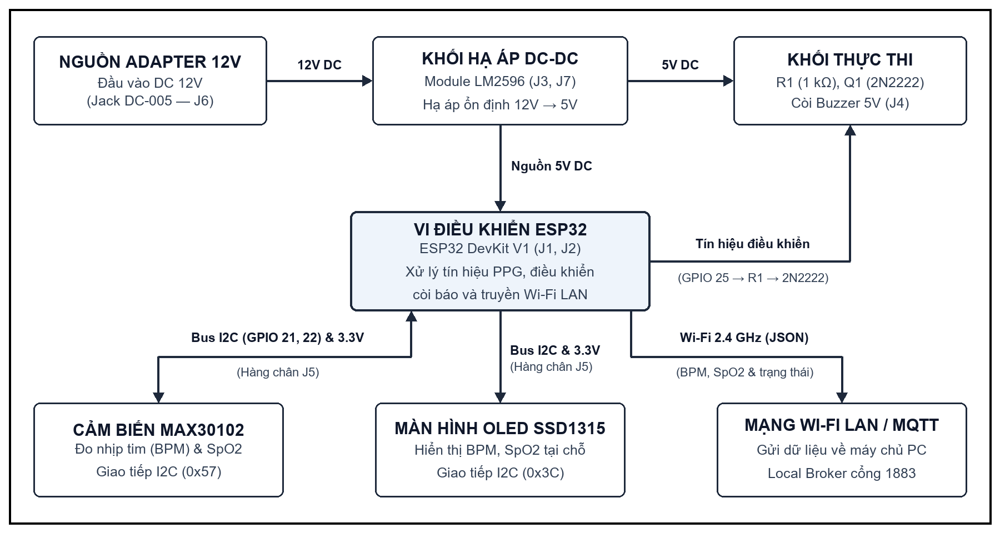
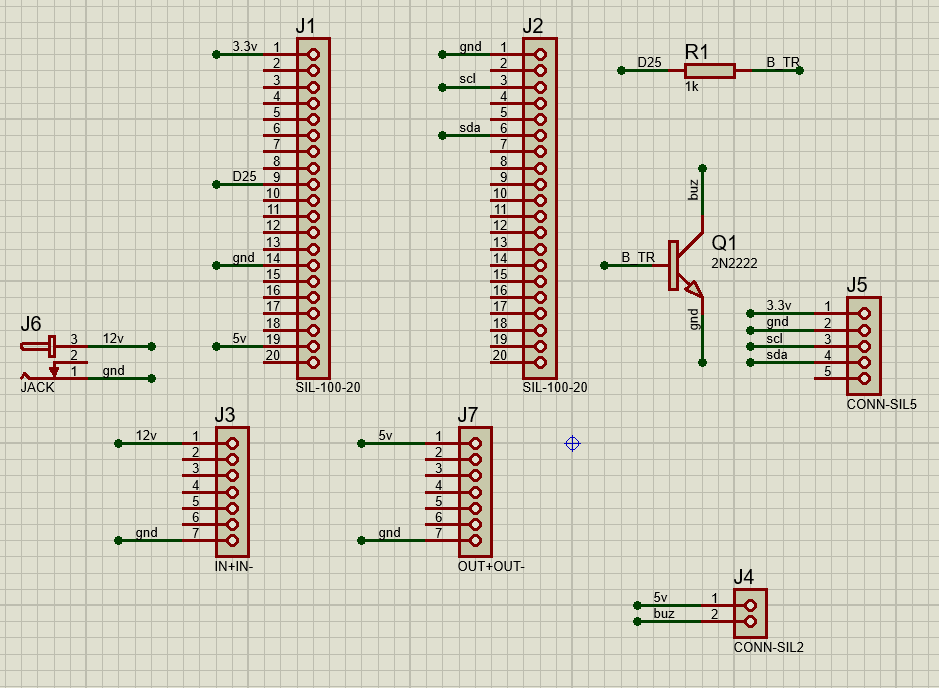
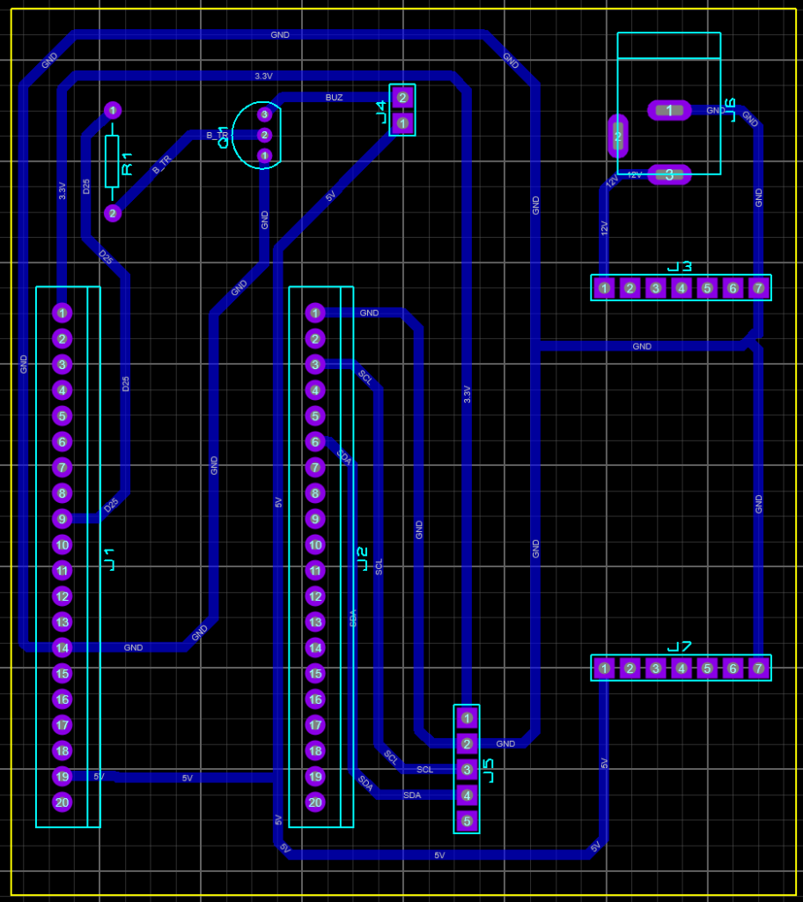

# Hệ thống IoT Giám sát Sức khỏe và Phát hiện Té ngã cho Người cao tuổi ở Viện Dưỡng Lão

**Môn học:** Kiến trúc và Giao thức IoT — Khoa Điện – Điện tử, Trường Đại học Tôn Đức Thắng (2026)  
**Nhóm thực hiện:** Hứa Vũ Duy (42300141) · Dương Thành Long (42300176)  
**Giảng viên hướng dẫn:** TS. Trần Thành Nam

---

## 1. Tổng quan hệ thống

Hệ thống vận hành khép kín trong mạng **Wi-Fi LAN nội bộ**, kết hợp 3 node vi điều khiển ESP32, Local MQTT Broker, thị giác máy tính YOLO11n trên GPU theo cơ chế bảo vệ quyền riêng tư (Camera Hybrid) và Web Dashboard phân quyền 3 vai trò bảo mật 2 lớp (2FA OTP qua Gmail):

- **Mạch không dây (Đai đeo ESP32 + MPU6050):** Lấy mẫu 6 trục ở 50 Hz qua Software I2C (chống treo bus), kết hợp thuật toán động học vector 3D và mạng nơ-ron đa lớp MLP lượng tử hóa Int8 (Edge Impulse TinyML). Kích còi tại chỗ ngay khi phát hiện té ngã và gửi cảnh báo qua Local MQTT (`:1883`).
- **Mạch cảm biến có dây (Trạm đầu giường ESP32 + MAX30102 + OLED SSD1315):** Đo nhịp tim (BPM) và SpO2 qua cảm biến quang học PPG, hiển thị trực tiếp lên màn hình OLED, phát còi bíp 5V xác nhận (qua transistor 2N2222) và đồng bộ qua Local MQTT.
- **Camera hiện trường (ESP32-CAM AI-Thinker OV3660/OV2640):** Tự đăng ký IP DHCP mỗi 10 giây. Mặc định ở chế độ chờ (`Standby`) bảo vệ riêng tư; tự động chụp ảnh và mở `Auto-Live` qua Single-Socket Proxy khi có cảnh báo té ngã, đẩy khung hình sang **AI Worker FastAPI + YOLO11n (GPU)** vẽ viền đỏ định vị người ngã (`te nga`).
- **Máy chủ trung tâm & Web Dashboard (`Node.js Express :3000` + `Aedes MQTT :1883` + `SQLite`):**
  - **Bác sĩ (`DOCTOR` — TK `1001`):** Xem sinh tồn/té ngã thời gian thực, mở Camera Live & nhận diện YOLO, xem ảnh sự cố và tắt còi cảnh báo (`BUZZER_OFF`).
  - **Người thân (`FAMILY` — TK `3003`):** Xem lịch sử BPM, SpO2 và sự kiện té ngã trong 7 ngày gần nhất (chặn Camera/còi với mã `403`).
  - **Kỹ thuật viên (`TECH` — TK `2002`):** Giám sát trạng thái Online/Offline 3 node (Watchdog 5s), nhật ký lỗi phần cứng, cảnh báo xâm nhập (`MQTT_INTRUSION`, `AUTH_BRUTE_FORCE`, `API_FORBIDDEN_ACCESS`) và lịch sử đăng nhập kèm phân loại IP 30 ngày.

---

## 2. Cấu trúc thư mục

```text
├── firmware_dai_lung_iot/      # Firmware ESP32 Mạch không dây (Đai đeo MPU6050 + TinyML)
├── firmware_node_wired/        # Firmware ESP32 Mạch có dây (MAX30102 + OLED SSD1315 + Buzzer)
├── firmware_camera/            # Firmware ESP32-CAM AI-Thinker (OV3660 / OV2640)
├── backend/                    # Máy chủ Node.js Express (:3000), Aedes MQTT Broker (:1883), SQLite
├── frontend/                   # Giao diện Web Dashboard 3 vai trò (HTML/CSS/JS thuần)
├── ai_worker/                  # Dịch vụ Python FastAPI (:8001) chạy YOLO11n (models/best.pt)
├── hardware/                   # Sơ đồ khối, sơ đồ nguyên lý & PCB Proteus (SCHE_GIUONG.pdsprj)
├── dataset/                    # 600 mẫu dữ liệu chuyển động 50 Hz huấn luyện TinyML
├── CHAY_HE_THONG.bat           # Script khởi chạy đồng bộ AI Worker và Backend
├── DONG_HE_THONG.bat           # Script dừng toàn bộ tiến trình hệ thống
└── tai-lieu-thuyet-minh-do-an-iot.md
```

---

## 3. Thiết kế phần cứng (Mạch cảm biến có dây)

| Sơ đồ khối | Sơ đồ nguyên lý (Proteus) | Mạch in PCB 1 lớp |
| :---: | :---: | :---: |
|  |  |  |

---

## 4. Hướng dẫn cài đặt và chạy nhanh

### 4.1. Cấu hình Backend & Web Dashboard
1. Cài đặt thư viện Node.js:
   ```bash
   cd backend
   npm install
   ```
2. Sao chép `backend/auth_config.example.json` thành `backend/auth_config.json`, sau đó điền Gmail gửi OTP, App Password 16 ký tự và email nhận OTP của 3 tài khoản (`1001`, `2002`, `3003`).

### 4.2. Cấu hình AI Worker (Python GPU)
```bash
pip install fastapi uvicorn ultralytics opencv-python-headless numpy
```
Trọng số tinh chỉnh sẵn nằm tại `ai_worker/models/best.pt`.

### 4.3. Khởi chạy hệ thống
Chạy file `CHAY_HE_THONG.bat` tại thư mục gốc (mở đồng thời AI Worker tại `127.0.0.1:8001`, Local MQTT Broker tại `:1883` và Web Dashboard tại `http://localhost:3000`). Dùng `DONG_HE_THONG.bat` để tắt toàn bộ dịch vụ.

### 4.4. Nạp Firmware cho 3 node ESP32
Trong mỗi thư mục `firmware_dai_lung_iot/`, `firmware_node_wired/`, `firmware_camera/`:
1. Sao chép `wifi_config.example.h` thành `wifi_config.h`.
2. Cập nhật `WIFI_SSID_CFG`, `WIFI_PASS_CFG` và `SERVER_IP_CFG` (IP LAN của máy chủ).
3. Mở file `.ino` bằng Arduino IDE và nạp xuống bo mạch ESP32 tương ứng *(với Đai đeo cần cài thêm thư viện Edge Impulse `te_nga_inferencing`)*.
